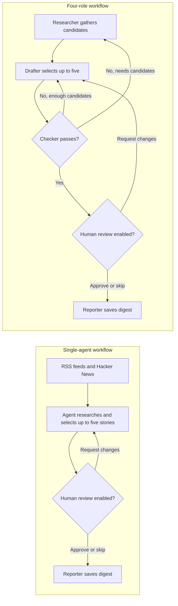

# Daily AI News Digest

A LangGraph app that gathers recent AI news and prepares a five-story digest. Choose a **single-agent workflow** for a simple baseline or a **four-role workflow** for separate research, drafting, and checking steps. The React UI supports review, run history, and usage metrics.

## Workflows

### Day 1: single agent

The single agent reviews the gathered candidates, can use search and feed tools when enabled, and selects up to five stories. You can approve the digest or send feedback and ask the agent to revise it. This baseline does not run the automated checker; the report states that explicitly.

### Day 2: four roles

1. **Researcher** gathers candidates from configured RSS feeds and Hacker News. Optional Tavily search can find more.
2. **Drafter** selects up to five stories and writes a short reason for each.
3. **Checker** runs date, URL, and duplicate checks, then optionally asks a checker model to review editorial issues. Rejected picks go back to the drafter; the loop is bounded.
4. **Reporter** writes the digest, run summary, token use, estimated cost, rejections, and open doubts.

Both workflows can pause for human approval. Nothing is published, posted, or emailed automatically.

### Workflow at a glance



## Setup

Requirements: Python and Node.js/npm. From the repository root, create and activate a virtual environment, install the Python packages, and copy the environment template:

```powershell
python -m venv .venv
.\.venv\Scripts\Activate.ps1
pip install -r requirements.txt
Copy-Item .env.example .env
```

Edit `.env` and add your provider keys. The template disables optional web search by default.

### Configuration

| Variable | Purpose |
|---|---|
| `MAIN_API_KEY` | Required for both run modes. Used by the main model. |
| `MAIN_BASE_URL` | Optional OpenAI-compatible API endpoint. Defaults to Google Gemini's OpenAI-compatible endpoint. |
| `MAIN_MODEL` | Optional main model ID. Default: `gemini-3.5-flash-lite`. |
| `CHECKER_API_KEY` | Required for the four-role workflow; unused by single-agent mode. |
| `CHECKER_BASE_URL` | Optional checker endpoint. Defaults to Groq's OpenAI-compatible endpoint. |
| `CHECKER_MODEL` | Optional checker model ID. Default: `openai/gpt-oss-120b`. |
| `USE_AGENT_SEARCH` | `1` enables model-directed search/feed tools; `0` disables them. Tavily search requires `TAVILY_API_KEY`. |
| `USE_LLM_REVIEW` | Enables the four-role checker's extra editorial review. Defaults to `1` when unset. |
| `REQUIRE_HUMAN` | CLI approval default. Defaults to `1`; the UI has a per-run approval option. |
| `PRICE_IN_PER_M`, `PRICE_OUT_PER_M` | Optional prices per million tokens for cost estimates. Defaults to `0`. |

Keep `.env` and provider keys out of Git. Check your provider's current model list if you override the model IDs.

## Run from the command line

From the repository root:

```powershell
python main.py                         # Four-role workflow; asks for human approval
python main.py --single-agent          # Day 1 single-agent workflow
python main.py --single-agent --no-human
python main.py --no-human              # Four roles without the terminal approval prompt
python main.py --test-checker          # Offline deterministic checker tests
```

`--baseline` is retained as an alias for `--single-agent`. The single-agent workflow only requires `MAIN_API_KEY`. The four-role workflow also requires `CHECKER_API_KEY`. If search tools are enabled, the CLI requires `TAVILY_API_KEY`.

## Run the web app

Start the API from the repository root:

```powershell
\.venv\Scripts\Activate.ps1
uvicorn server:app --port 8000
```

In another terminal, start the Vite development server:

```powershell
cd digest-ui
npm install
npm run dev
```

Open the local Vite URL shown in the terminal (usually `http://localhost:5173`). The Run page lets you choose **Day 1 - Single agent** or **Day 2 - Four roles**, and whether to require approval. The Dashboard shows tokens, latency, estimated cost, checker results, source errors, and rate-limit waits. Logs and History retain prior run details.

For a built UI, run `npm run build` inside `digest-ui`, then start the API. The server serves `digest-ui/dist` when that directory exists.

## Deploy on Render

The repository includes a `render.yaml` Blueprint and a Dockerfile. Render builds the React UI and Python API into one web service, so the UI and API share one URL and no database is needed for the daily digest.

1. Push the repository to GitHub and create a **New Blueprint** in Render, selecting this repository.
2. Enter `MAIN_API_KEY` and `CHECKER_API_KEY` from your model providers, plus a strong, unique `APP_PASSWORD` for the site. Keep these values in Render's environment settings, never in Git.
3. Deploy the Blueprint. Open its `onrender.com` URL; the browser will request the site password. Use any username and the `APP_PASSWORD` value. The password gate protects the UI and API from unauthorized runs that could use your model credits.

Web search is disabled in the Blueprint by default, so a Tavily key is not required. Set `USE_AGENT_SEARCH=1` and add `TAVILY_API_KEY` in Render if you want it enabled. Run logs and reports are stored as local files; on Render's default ephemeral filesystem, they can be lost when the service restarts or redeploys. You can add file persistence later without introducing a database.

## Test set and benchmark

Run the offline checker examples with:

```powershell
python main.py --test-checker
```

To score the Excel case set, place `test_set.xlsx` at `reports/test_set.xlsx` or pass its path:

```powershell
python benchmark_test_set.py
python benchmark_test_set.py path\to\test_set.xlsx
```

The benchmark uses Python's standard library to read the workbook; it does not require an Excel package. It compares one all-in-one classification call with a Researcher/Drafter/Checker role flow and writes JSON predictions plus a Markdown score report under `reports/`. It scores per-row labels, AI relevance, checker tags, and event grouping. It sends case data to the model APIs configured in `.env`.

**Benchmark scope:** this workbook benchmark classifies the rows. It does not measure whether a generated top-five digest meets the brief's human-accepted 4-of-5 success metric. Use its scores as row-classification results, not as the Day 1 vs Day 2 digest score.

## Defaults and limits

- The researcher reads seven configured RSS feeds and Hacker News, using a 48-hour candidate window.
- Picks must be within the last 24 hours. The digest target is five stories; the drafter sees at most 30 eligible candidates balanced across publishers. When at least three publishers have eligible stories, the drafter aims to include at least three; the four-role checker sends a more concentrated draft back for revision.
- Search tool calls are capped at five per research/tool loop. Checker failures and human revision rounds are bounded.
- Link checks may be inconclusive when a source blocks automated requests; those cases are reported as doubts.
- Run logs are JSONL under `logs/`. Digest Markdown, picked-story JSON, and benchmark reports are written under `reports/`. Both directories are Git-ignored.

## API endpoints

The FastAPI server exposes:

| Endpoint | Use |
|---|---|
| `POST /api/runs` | Start a run with `{"mode":"single_agent"}` or `{"mode":"four_roles"}` and optional `require_human`. |
| `GET /api/state?since=0` | Poll run status, results, and new log events. |
| `POST /api/decision` | Approve or reject a pending digest and optionally provide feedback. |
| `GET /api/config` | Read model and runtime settings (never API keys). |
| `GET /api/history` | List saved runs. |
| `GET /api/history/{run_name}` | Read a saved run's event log. |
